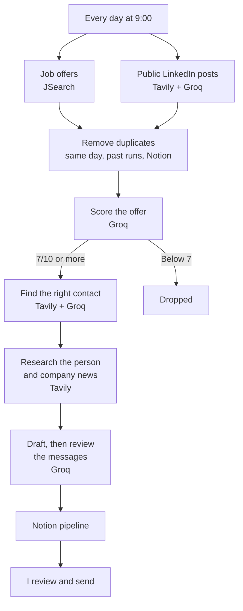

# Internship Prospecting Agent

An n8n workflow that looks for internship offers every morning, scores them against my profile, finds the right person to contact and drafts a personalized LinkedIn message. Everything lands in a Notion pipeline, and I review and send each message myself.

**Running cost: €0** (self-hosted n8n and free API tiers).

## How it works

1. **Find offers.** Six JSearch queries cover Google for Jobs, and four Tavily searches look for public LinkedIn posts announcing an internship. An LLM keeps only the posts that advertise an open internship.
2. **Remove duplicates.** Each offer gets a stable key (company + job title keywords), so a reposted offer or the same offer on another site is recognized. It is checked against the current run, past runs and the Notion database.
3. **Score.** The LLM rates four criteria and the code adds them up, which keeps scores far more consistent than asking for one overall grade. Offers scoring 7 or more continue.

   | Criterion | Points |
   |---|---|
   | Role fit (growth, business development, GTM) | 0-4 |
   | Timing (6 months from January 2027) | 0-2 |
   | Company type (tech startup or scale-up) | 0-2 |
   | Location (Paris preferred) | 0-2 |

4. **Find the contact.** The agent searches public LinkedIn profiles and keeps only those that mention the hiring company. The LLM then picks the likely manager, founder or recruiter. It can only choose from the profiles it was given, and the code rejects any profile URL that is not in that list.
5. **Write the message.** Using recent facts about the person and the company, one LLM drafts a connection note and a follow-up message. A second one checks them against the sources, corrects them and rates how personalized they are.
6. **Log to Notion.** Messages that pass the checks are marked *À contacter* (to contact). Anything uncertain, such as a doubtful contact, low personalization or a banned phrase, is marked *À relire* (to review), with the reason.

Duplicates already in Notion are moved to the trash on each run, and rows I have already worked on are never removed.

## Design choices

- **Human in the loop:** the agent never sends anything.
- **No LinkedIn scraping or login automation:** it only uses public, search-indexed data.
- **Protection against made-up facts:** messages can only use retrieved facts, and an LLM review plus code checks run before anything reaches the pipeline.
- **Free-tier friendly:** filters run before each step that uses API quota, with batching and retries.

## Stack

| Tool | Role |
|---|---|
| [n8n](https://n8n.io) (self-hosted) | Orchestration |
| [JSearch](https://rapidapi.com/letscrape-6bRBa3QguO5/api/jsearch) | Job offers |
| [Tavily](https://tavily.com) | Web search: LinkedIn posts, profiles, news |
| [Groq](https://groq.com) (`openai/gpt-oss-120b`) | LLM: scoring, contact choice, messages |
| [Notion](https://www.notion.com) | Pipeline |

## Setup

1. Import `internship-prospecting-agent.json` into n8n.
2. Create the credentials. The first three are Header Auth:

   | Credential | Header | Value |
   |---|---|---|
   | JSearch | `X-RapidAPI-Key` | your key |
   | Tavily | `Authorization` | `Bearer <key>` |
   | Groq | `Authorization` | `Bearer <key>` |
   | Notion | Notion API credential | your integration token |

3. Create a Notion database with these properties, then select it in the **Lire Notion** and **Envoi Notion** nodes:
   - **Title:** `Entreprise`
   - **Text:** `Poste`, `Raison`, `Contact`, `Poste contact`, `Accroche`, `Message connexion`, `Message suivi`, `ID offre`, `Source`, `Preuve utilisée`, `Pourquoi ce contact`
   - **Number:** `Score`, `Personnalisation`
   - **URL:** `LinkedIn contact`, `Lien offre`
   - **Select:** `Statut` (at least `À contacter`, `À relire`), `Confiance contact` (`haute`, `moyenne`, `faible`, `aucune`)
4. Adapt the search queries in **Requêtes JSearch** and **Requêtes posts LinkedIn**, and the profile in **Scoring IA**, **Message IA** and **Relecture IA**.

Node names and prompts are in French, as the agent targets the French market.
